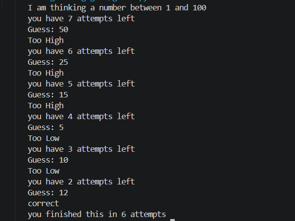

# Number Guessing Game

## About the project
A terminal game where the computer picks a secret number between 1 and 100, and you have 7 attempts to guess it. After every wrong guess it says "Too High" or "Too Low" and how many attempts you have left.



## How to run it
You need Python 3. In Git Bash or cmd:
```
git clone https://github.com/bhargavsaideekonda/number-guessing-game.git
cd number-guessing-game
python guess.py
```
Type a number and press Enter. If you type something that isn't a number, it asks again without using up an attempt.

## What I built myself
- The game logic: `random.randint(1, 100)` picks the secret number, and each guess is compared with it to print "Too High", "Too Low" or "correct".
- Input handling: `try`/`except ValueError` catches input that isn't a number, so the game doesn't crash.
- A `while` loop that keeps asking until you guess the number or use all 7 attempts.

I built this with step-by-step help from Claude, an AI tutor. It helped plan the stages and explained the errors I hit. I typed and ran every line myself.